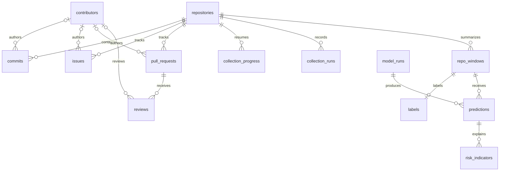

# Database guide

PostgreSQL stores the collected GitHub records and the results computed by the offline research pipeline. Flyway is the only schema owner; Spring Boot reads the stored data and does not create or update database objects. Migration V3 extends the V2 repository table and adds the core collection, window, label, model, and prediction tables. Migration V4 adds per-stage collection run history. Migration V5 adds Phase 4 run stages and GitHub review IDs for idempotent upserts. No Java entities are needed for this schema.

All timestamps use `TIMESTAMPTZ` and represent UTC instants. Primary keys are `BIGINT GENERATED ALWAYS AS IDENTITY`. Contributor identity is stored only as a keyed HMAC-SHA256 `contributor_key`; names, logins, email addresses, and raw GitHub user IDs are not stored. Unknown GitHub authors and reviewers remain `NULL` so their records are preserved without invented identities.

## Tables

- `repositories` stores the GitHub repository ID and full name, language, star count, cohort version, active state, creation time, and time added to the study. V2 fields remain for compatibility with cohort selection. `owner`, `name`, `stars`, `github_created_at`, and `is_active` are generated from the existing V2 columns. Existing memberships backfill `cohort_version` from the latest cohort name; repositories without a membership use `unassigned`. Existing rows map `added_at` from `selected_at`.
- `contributors` stores a unique, lowercase 64-character SHA-256 key, a bot flag, and the first observed timestamp. It intentionally contains no login, name, email, or raw GitHub user ID.
- `commits` stores repository commit SHAs, commit timestamps, and an optional link to an anonymized contributor. A repository cannot contain the same SHA twice.
- `issues` stores non-pull-request issues, GitHub issue numbers, optional anonymized authors, creation and closure times, and the first response time.
- `pull_requests` stores GitHub pull-request numbers, optional anonymized authors, state, creation/merge/closure/first-response times, and the repository relationship.
- `reviews` stores the GitHub review ID, submitted or pending state and time for a pull request, with an optional anonymized reviewer. A partial unique index on `(pull_request_id, github_id)` supports idempotent upserts.
- `collection_progress` stores one resumable collection checkpoint per repository and resource. It can retain a cursor, a page number, status, request count, and last update time.
- `collection_runs` records each repository metadata or commit collection attempt, its start and finish times, status, API request count, record count, and a bounded error summary. A still-running row identifies a process interrupted before it could record completion.
- `repo_windows` stores a repository's time-bounded feature summary: contributor counts and diversity, newcomer retention, response and merge times, pull-request and review counts, activity score, and trend slopes. Unavailable measurements stay `NULL`. A window must end after it starts, and each repository has at most one row per end time.
- `labels` stores the outcome for a window: forecast horizon, future activity score, decline ratio, decline flag, and label version. Labels describe future outcomes and must never be included as predictors for that same window.
- `model_runs` stores the model family and version, chronological train/test boundaries, evaluation metrics, parameters, primary-model flag, and creation time. Train end must be on or before test start; metrics are bounded from zero to one. At most one model run can be primary at a time.
- `predictions` stores a model run's risk score and low/medium/high category for a repository window. Risk scores are between zero and one, and a model run can predict a window only once.
- `risk_indicators` stores ranked, nonnegative feature weights and their risk direction and description for a prediction. A prediction cannot repeat a rank.

Foreign keys cascade when dependent repository data or derived results are removed. Deleting a contributor sets attribution links to `NULL`; deleting a pull request removes its reviews. This preserves collected events when an anonymized contributor record is removed.

## Relationships



`v_repo_latest_risk` is a read-only view over repositories, model runs, predictions, and windows. It returns the latest available window prediction from the primary model only. Repositories with no primary-model prediction do not appear in the view.

## Writers and readers

| Table or view | Writer | Reader |
|---|---|---|
| `repositories` | Cohort selection and repository-metadata collection in the Python pipeline | Python collection/features and Spring Boot API |
| `contributors` | Python collection pipeline | Python feature pipeline and Spring Boot API |
| `commits` | Python commit collector | Python feature pipeline and Spring Boot API |
| `issues` | Python issue collector | Python feature pipeline and Spring Boot API |
| `pull_requests` | Python pull-request collector | Python feature pipeline and Spring Boot API |
| `reviews` | Python review collector | Python feature pipeline and Spring Boot API |
| `collection_progress` | Python collectors | Python resume/status reporting and Spring Boot API |
| `collection_runs` | Python collectors | Python collection reports and read-only SQL inspection |
| `repo_windows` | Python snapshot and feature stages | Python model/prediction stages and Spring Boot API |
| `labels` | Python label stage | Python evaluation stage and Spring Boot API |
| `model_runs` | Python training/evaluation stage | Python prediction stage and Spring Boot API |
| `predictions` | Python prediction stage | Spring Boot API |
| `risk_indicators` | Python explanation stage | Spring Boot API |
| `v_repo_latest_risk` | None; Flyway defines the view | Spring Boot API and read-only SQL inspection |

Flyway migrations are the only database-structure writer. The dashboard reads through the Spring Boot API and never connects directly to PostgreSQL.

## Phase 3 collection

The Python collector writes repository metadata and commit history to `repositories`, `contributors`, and `commits`. Each API page is committed together with its next cursor in `collection_progress`; conflict-safe keys make retries idempotent. The local cache stores JSON after privacy filtering, together with ETags and pagination links. Run output is written to ignored `pipeline/data/` paths, and `collection_runs` retains per-stage outcomes in PostgreSQL.

## Development seed

The SQL seed contains three clearly synthetic repositories, twelve monthly windows per repository, labels, one primary baseline model, predictions, and two indicators per prediction. It lives outside Flyway's `db/migration` directory, so application startup never loads sample data. Run it only against a local development database after migrations have applied:

```sh
docker compose up -d postgres
docker compose exec -T postgres psql -U ossustain -d ossustain -v ON_ERROR_STOP=1 < backend/src/main/resources/db/dev-seed/dev_seed.sql
```

In PowerShell, send the file through standard input:

```powershell
Get-Content -Raw backend/src/main/resources/db/dev-seed/dev_seed.sql | docker compose exec -T postgres psql -U ossustain -d ossustain -v ON_ERROR_STOP=1
```

The script uses stable demo GitHub IDs and conflict handling, so rerunning it refreshes the same sample rows. It marks the development baseline as primary; use a fresh or otherwise unassigned development database if a different model run is already primary.
